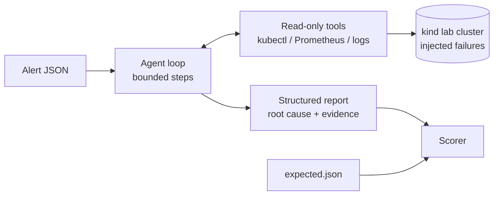

# k8s-sre-agent

[](https://github.com/Bilalkhanten/k8s-sre-agent/actions/workflows/ci.yml)
[](LICENSE)

An open-source **AI incident investigator for Kubernetes**. Give it an alert; it investigates the
cluster with **read-only tools** and returns a structured root-cause report with linked evidence.
Every behaviour is **scored against ground truth** in a reproducible failure lab, so claims about
the agent can be measured rather than assumed.

> **Status: early / pre-alpha.** The failure lab, scenario format and read-only tools layer are in
> place. The agent loop and scorer are next - see the [roadmap](#roadmap).

## Why

AI SRE demos are easy; trustworthy ones are not. This project focuses on the parts that make an
incident agent safe to put near production:

- **Evals first** - six realistic failures with expected root cause, required evidence and
  red herrings, so accuracy is a number.
- **Safety by construction** - read-only RBAC, bounded steps and an audit log, not "please don't
  delete anything" in a prompt.
- **Reproducible** - one command builds the lab; one command injects a fault.

## Architecture



## Quickstart

Requires Python 3.11+, [`uv`](https://docs.astral.sh/uv/), and for the lab: Docker, `kind`,
`kubectl`, `helm`.

```bash
git clone https://github.com/Bilalkhanten/k8s-sre-agent && cd k8s-sre-agent
make install
make check                      # lint, tests, scenario validation

make lab-up                     # kind cluster + demo app + monitoring
make scenarios-list
make scenario-up S=oom-killed   # inject a fault
kubectl -n demo get pods        # watch it break
make scenario-down S=oom-killed
make lab-down
```

## Scenarios

| ID | Difficulty | Failure |
|---|---|---|
| `oom-killed` | easy | Container exceeds its memory limit and is OOMKilled |
| `image-pull-backoff` | easy | Deployment references an image tag that does not exist |
| `failing-readiness-probe` | medium | Readiness probe hits a 404 path; Service has no endpoints |
| `quota-exceeded` | medium | ReplicaSet cannot create pods because the namespace quota is full |
| `networkpolicy-block` | hard | A NetworkPolicy silently drops traffic from the calling service |
| `bad-config-rollout` | hard | New revision references a missing ConfigMap key; rollout stalls |

Each scenario is a directory with `manifest.yaml` (the fault), `alert.json` (agent input),
`expected.json` (ground truth) and an optional `setup.yaml`. Conventions are enforced by
`k8s-sre-agent scenarios validate`. Adding a scenario is the easiest way to contribute.

## Tools

The agent can only act through these tools. All of them are read-only, validate their
arguments, redact secrets, bound their output and write one audit record per call.

| Tool | What it returns |
|---|---|
| `list_pods` | Phase, readiness, restarts, container states (incl. last termination such as `OOMKilled`), labels, owner |
| `get_events` | Recent events in a namespace, oldest first; filter by object or warnings only |
| `get_logs` | Tail of a container's logs (`previous=true` for crashed containers), secrets redacted |
| `describe` | `kubectl describe` for pods, workloads, services, network policies, quotas, nodes. ConfigMaps return key names only |
| `query_prometheus` | Instant or last-N-minutes PromQL, capped to 10 series x 20 points |

How read-only is enforced, innermost first:

1. **RBAC** ([`lab/rbac/readonly.yaml`](lab/rbac/readonly.yaml)): `get`/`list`/`watch` only, no
   `secrets`, no `pods/exec`, no wildcards. A test pins this down.
2. **Pinned identity**: tools run `kubectl` only with the agent kubeconfig, never your admin
   context, and refuse `--as`, `--token`, `--server` and friends.
3. **Allowlisted verbs**: `get`, `describe`, `logs`; arguments are validated against DNS-1123
   patterns and passed as a list (no shell).

```bash
make lab-up
make agent-kubeconfig                              # applies RBAC, writes .kube/agent.kubeconfig
make scenario-up S=oom-killed
uv run k8s-sre-agent tools call list_pods '{"namespace": "demo"}'
uv run k8s-sre-agent tools call describe '{"kind": "pod", "name": "<pod>", "namespace": "demo"}'
make lab-test                                      # integration tests against the live lab
```

Prometheus is not governed by Kubernetes RBAC; its tool can only `GET /api/v1/query[_range]`
against an operator-configured URL (`PROMETHEUS_URL`, default `http://localhost:9090`; use
`kubectl -n monitoring port-forward svc/monitoring-kube-prometheus-prometheus 9090:9090`).

## Roadmap

- [x] Project scaffold, CI, scenario format and validator
- [x] Local lab (kind + demo app + Prometheus/Alertmanager) and six failure scenarios
- [x] Read-only tools layer (pods, events, logs, describe, PromQL) under a read-only ServiceAccount
- [ ] Agent loop with structured report output
- [ ] Eval harness: score root cause, evidence and red-herring handling; publish results here
- [ ] Guardrails: step/token budgets, secret redaction, audit log, dry-run
- [ ] Alertmanager webhook receiver and deployment guide

## Safety principles

1. Cluster access is read-only by default, enforced by Kubernetes RBAC.
2. Secrets are redacted before anything reaches a model.
3. Every run is bounded and every tool call is logged.

## License

[Apache-2.0](LICENSE)
